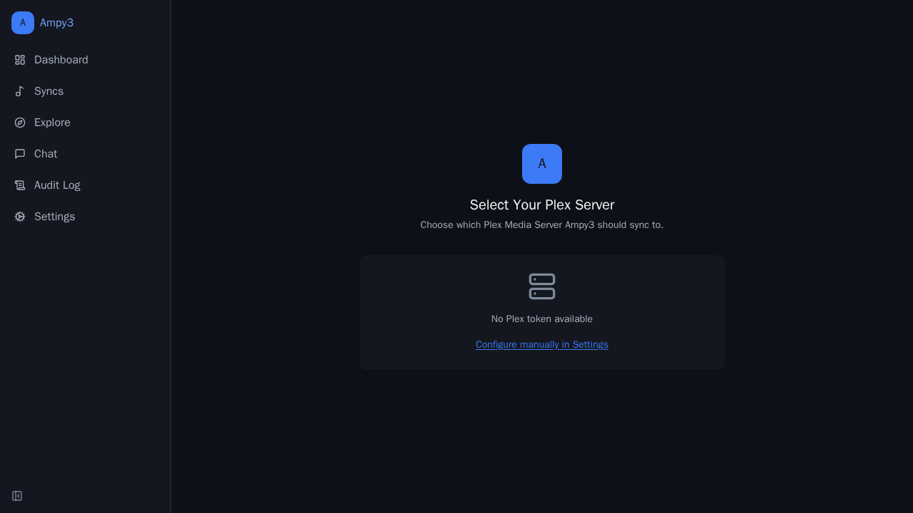
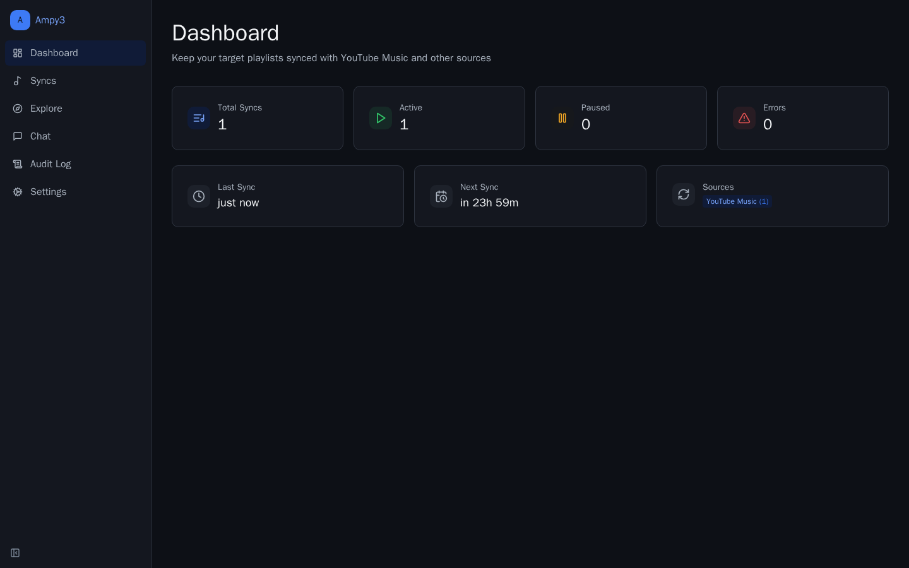
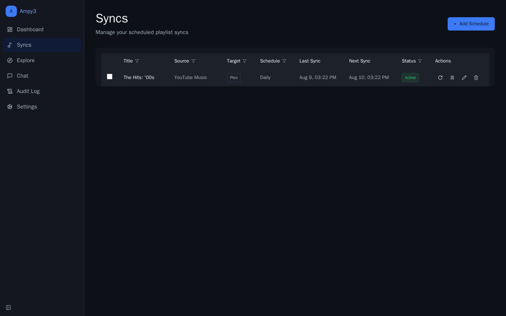
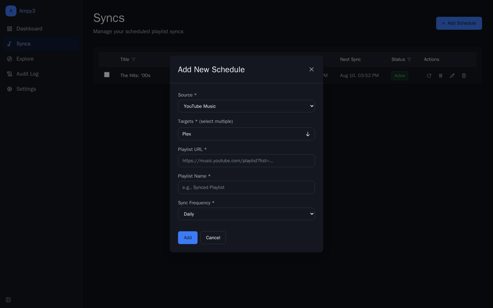
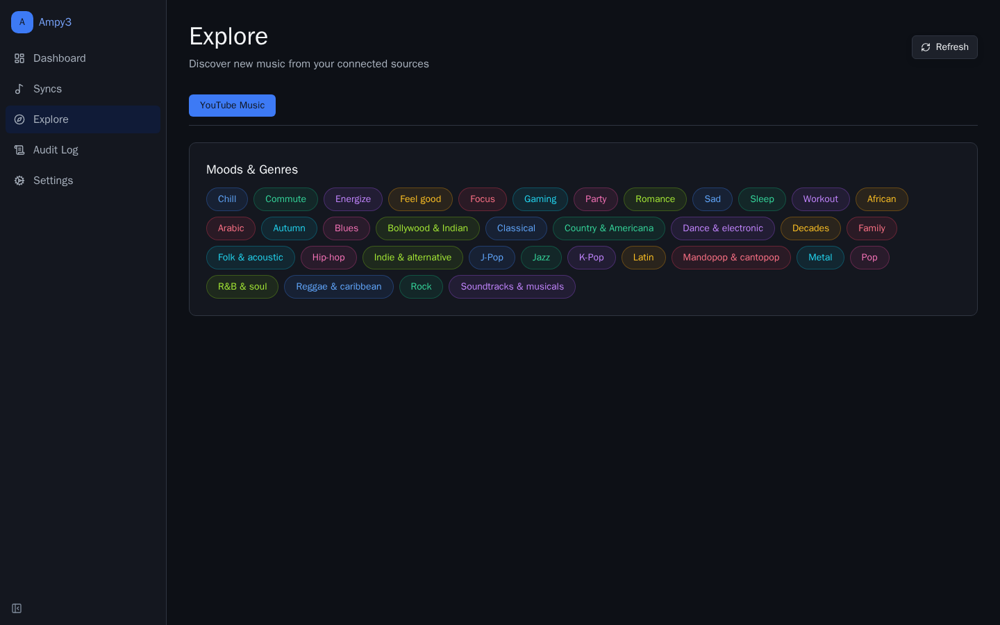
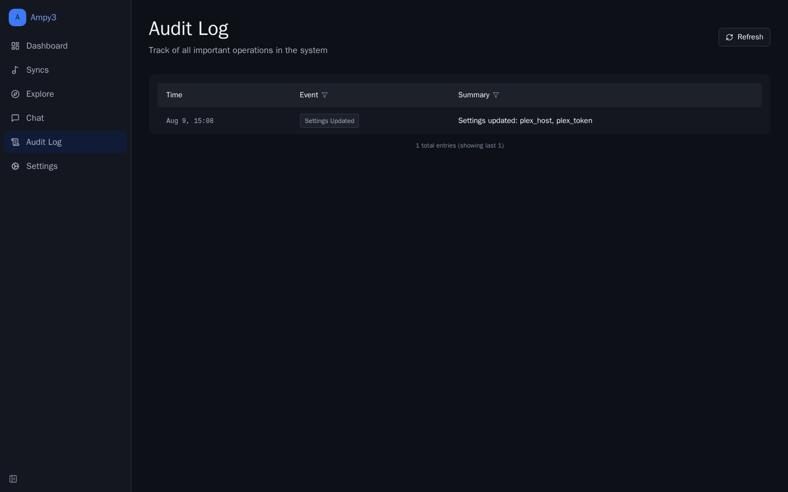
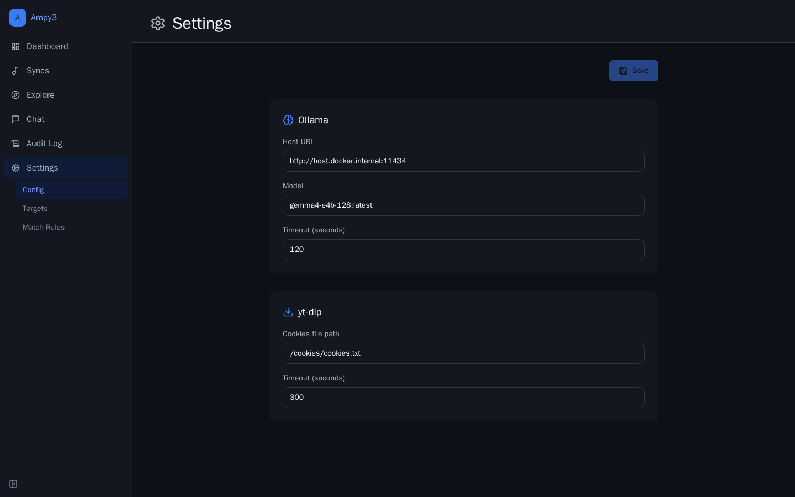
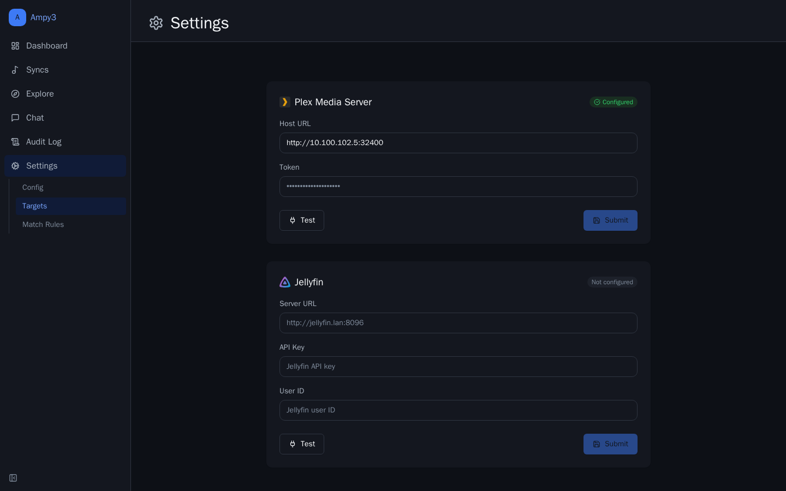
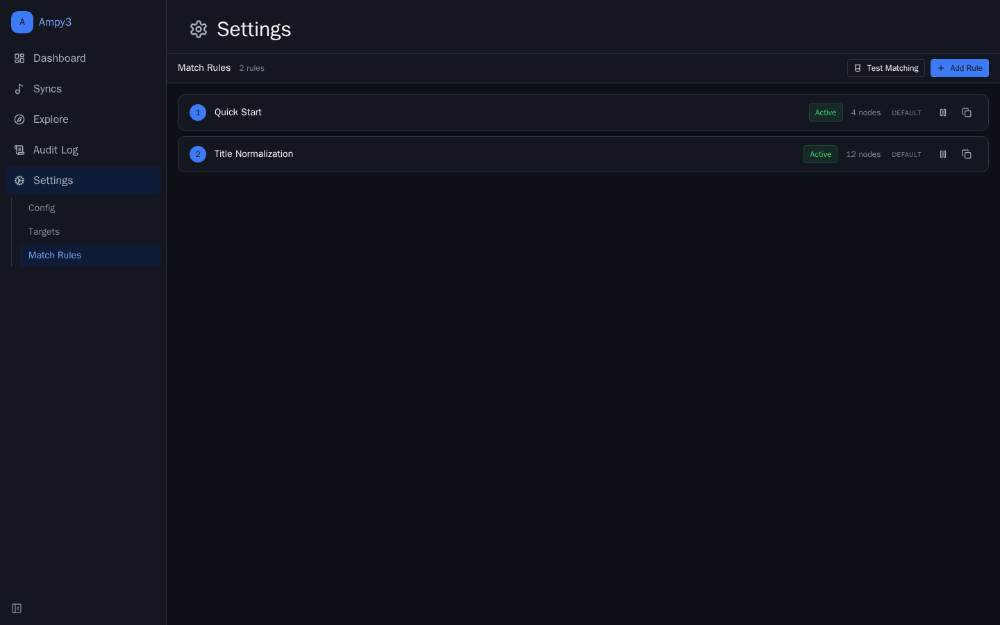

# Ampy3

[](https://github.com/JakePeralta7/Ampy3/actions/workflows/ci.yml)

Syncs YouTube Music playlists to Plex or Jellyfin using MusicBrainz IDs for metadata matching.

## Quick Start

```bash
git clone https://github.com/JakePeralta7/Ampy3 && cd Ampy3
cp .env.example .env
# Edit .env: set a strong POSTGRES_PASSWORD and generate SECRET_KEY with
#   python -c "import secrets; print(secrets.token_hex(32))"
docker compose up --build -d
```

Open `http://localhost:8000` and sign in with Plex — the first sign-in
becomes the single owner account (only one owner is ever stored). Then
complete setup/configuration to connect your target server.

The API binds to `127.0.0.1` by default, so it is only reachable from this
machine. To expose it to your LAN set `APP_BIND=0.0.0.0` in `.env`.
Authentication (`REQUIRE_AUTH`) defaults to **enabled**; set it to `false`
only for trusted local networks without internet exposure.

## Screenshots



















On first launch Ampy3 walks you through selecting your Plex server. Other pages (Dashboard, Syncs, Explore, Audit Log, Settings) unlock once a target server is configured.

## Stack

- **Backend:** Python / FastAPI + Celery workers
- **Frontend:** React / TypeScript / Tailwind
- **Infra:** Docker Compose, PostgreSQL, Valkey (Redis)
